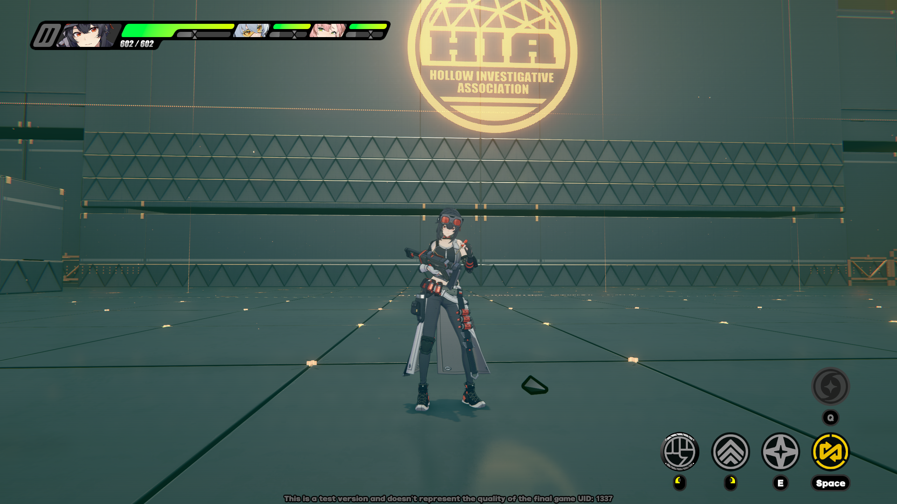

# GracefulZoneZero
A free and open-source server emulator for the Equalizing Test version of Zenless Zone Zero.


## Requirements
- Zig 0.17.0: [Linux](https://ziglang.org/download/0.17.0/zig-x86_64-linux-0.17.0.tar.xz)/[Windows](https://ziglang.org/download/0.17.0/zig-x86_64-windows-0.17.0.zip)
- ZZZ CB2 Client (OSCBWin0.2.0)
- Client patch: [GracefulPatch](https://git.xeondev.com/GracefulZoneZero/GracefulPatch)

## Building from sources
First, make sure you have zig compiler of the required version available:
```sh
$ zig version
0.17.0
```

If the output matches, simply run
```sh
zig build
```
The server binaries should appear in the `zig-out/bin` directory.

## Setup
The configuration of servers is done via `.zon` configuration files and command line arguments. See `--help` message of each server for more info. Default configuration files can be found in the `defaults` directory.

You have to start 3 servers: `grace-dispatch-server`, `grace-sdk-server`, `grace-game-server`.
See also [GracefulPatch documentation](https://git.xeondev.com/GracefulZoneZero/GracefulPatch) before trying to connect.

## Features
GracefulZoneZero is in early state of development, currently implemented:
- Logging in
- Training room
- Overworld quick travel
For the implementation roadmap, see [the issue tracker](https://git.xeondev.com/GracefulZoneZero/GracefulZoneZero/issues).

## Goals
- A robust, dependency-free codebase, guided by design philosophies outlined in [TigerStyle](https://tigerstyle.dev/) and [The Power of 10](https://en.wikipedia.org/wiki/The_Power_of_10:_Rules_for_Developing_Safety-Critical_Code).
- Feature-complete implementation of the game logic, including main story.

## Contributing
[Donate](https://boosty.to/xeondev/donate).

[Join project-specific discord server](https://graceful.xeondev.com).

[Join ReversedRooms discord server](https://discord.xeondev.com).

[Join ReversedRooms telegram channel](https://t.me/reversedrooms).
